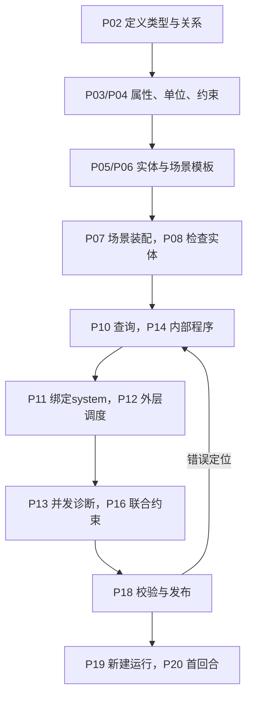
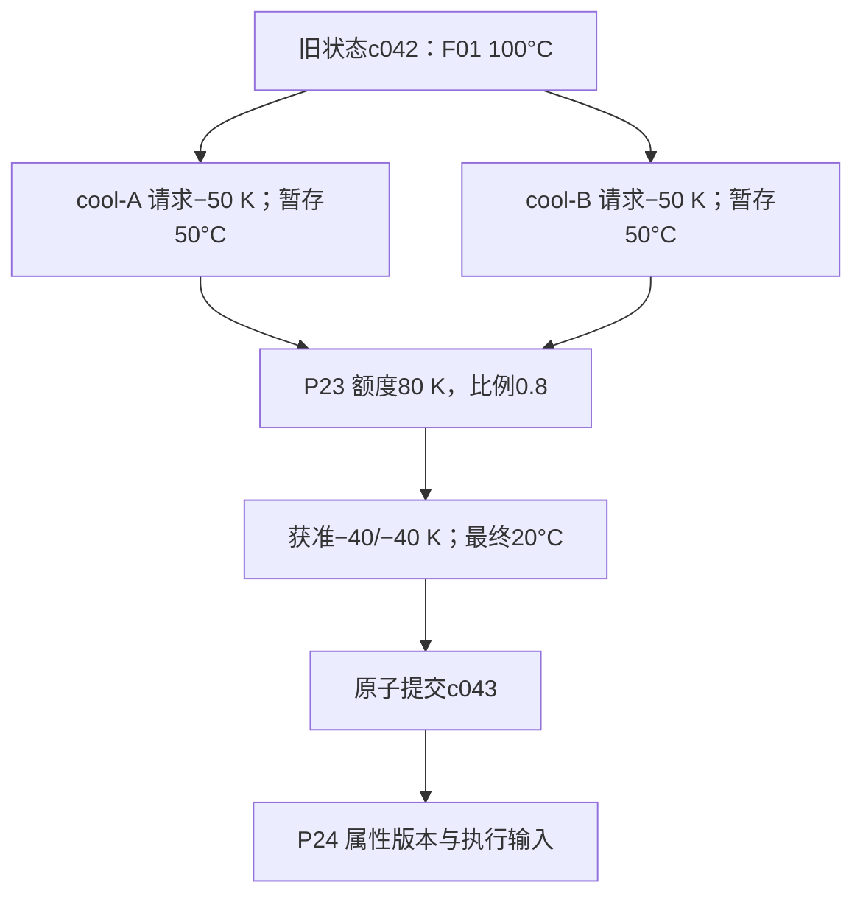
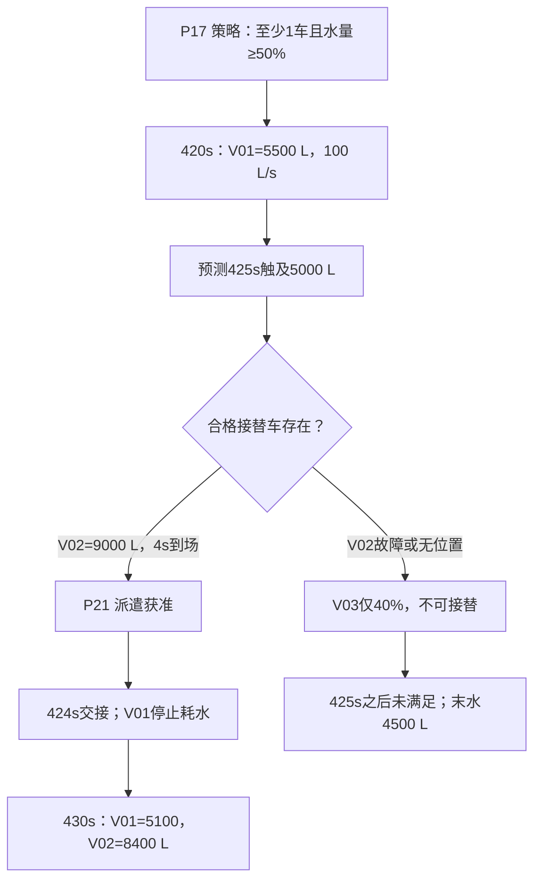
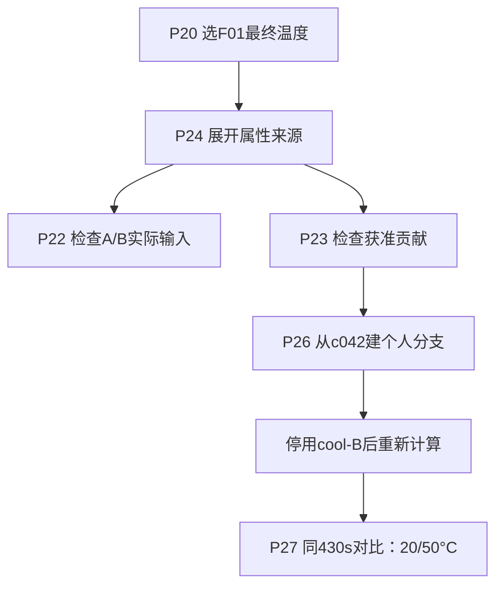

# 页面中的业务流转

## 一、从空白模型到首次演练

页面呈现：对象创建后进入草稿；每步的引用选择器只选已存在且兼容的对象。发布页面统一固定版本。首次进入运行不自动结算。场景初值与模板默认值可能不同，P05显示默认、P07显示实例覆盖，P20显示运行值。

## 二、双路冷却与裁决

P12显示并行组，P14显示产生请求的节点，P22按实体展示旧值/暂存/请求/获准/最终，P23解释分配，P24追踪输入版本。不是把最终温度20°C直接写进五个页面的静态文本。

|火源|旧温度°C|A/B请求K|A自身预览°C|获准A/B K|最终°C|
|---|---:|---|---:|---|---:|
|F01|100|−50 / −50|50|−40 / −40|20|
|F02|80|−50 / −50|30|−30 / −30|20|
|F03|60|−40 / −40|20|−20 / −20|20|

本例明确采用同温恒温冷源的冷却额度模型。不扩展为不同冷源、同时加热、有限热容量下的通用物理定律。若接入真实热量守恒，应替换领域求解器与关联效果契约。

## 三、提前接替与不满足分支

P28展示时间区间与候选排除原因；P25区分预测、派遣、到达、交接事件。V02到达前在前往状态满足策略“前往或处置”资格，但V01按更严格的到场交接规则保持处置，避免物理服务中断。两车短暂重叠符合“至少1辆”，不得误用“恰好1辆”。

## 四、来源分析与反事实

来源图解释程序如何得到结果；事件链解释已记录的业务关系；分支比较对同一基准和时间的结果做反事实检查。三者跳转互通，不能把单条时间顺序当因果证据。
