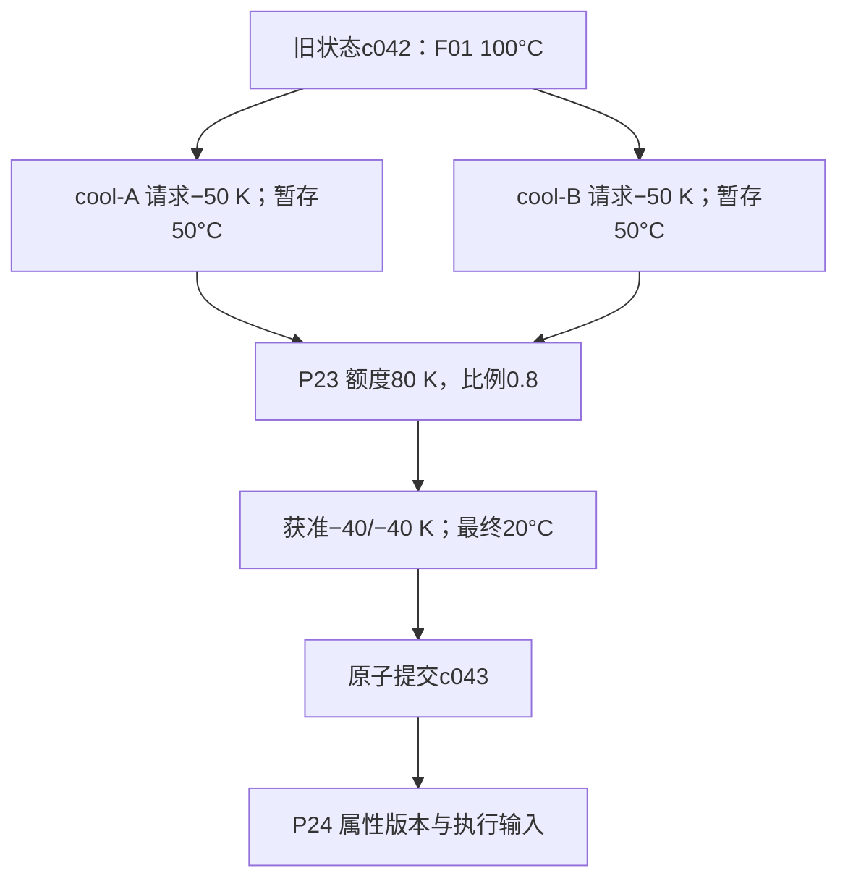

# 二、双路冷却与裁决

P12显示并行组，P14显示产生请求的节点，P22按实体展示旧值/暂存/请求/获准/最终，P23解释分配，P24追踪输入版本。不是把最终温度20°C直接写进五个页面的静态文本。

|火源|旧温度°C|A/B请求K|A自身预览°C|获准A/B K|最终°C|
|---|---:|---|---:|---|---:|
|F01|100|−50 / −50|50|−40 / −40|20|
|F02|80|−50 / −50|30|−30 / −30|20|
|F03|60|−40 / −40|20|−20 / −20|20|

本例明确采用同温恒温冷源的冷却额度模型。不扩展为不同冷源、同时加热、有限热容量下的通用物理定律。若接入真实热量守恒，应替换领域求解器与关联效果契约。
